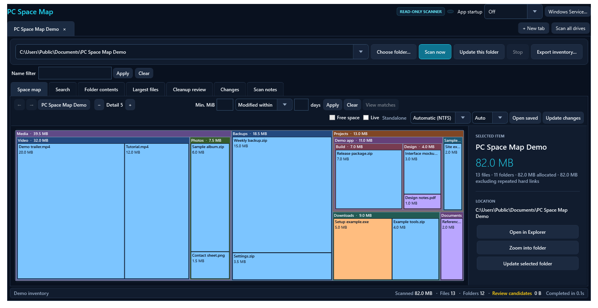
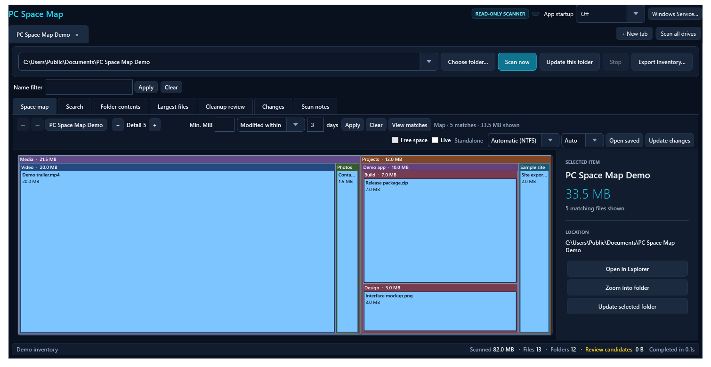
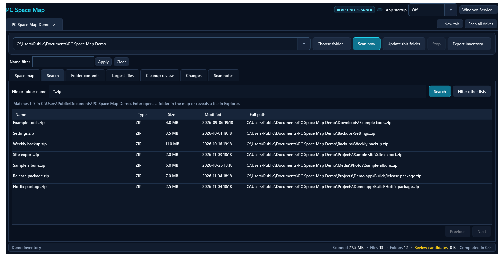
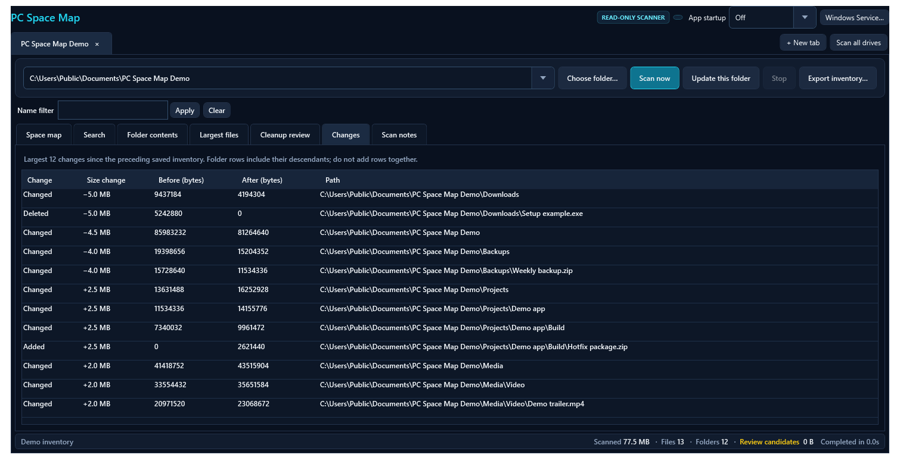

# PC Space Map

## Build on GitHub

Open [Actions](https://github.com/RazvanManolache/pc-space-map/actions/workflows/build.yml), choose **Run workflow**, and select the branch. Builds also run on pushes and pull requests. Open a successful run and download its **Artifacts** (GitHub sign-in required; retained for 30 days).

The download contains a self-contained Windows x64 portable ZIP, an MSI installer, and SHA-256 checksums. The workflow runs the offline regression suite before packaging. These are unsigned development builds.

PC Space Map is a read-only Windows disk inventory app inspired by tools like SpaceSniffer. It scans a drive or folder, renders a treemap of storage usage, highlights large files, and groups conservative cleanup candidates without deleting anything.

Download the [Windows x64 installer from GitHub Releases](https://github.com/RazvanManolache/pc-space-map/releases/latest). The installer includes the desktop app and an optional Windows indexing service.

## Features in 2.4.9

| Feature | Why it helps |
| --- | --- |
| Saved indexes and an optional Windows service | Open a completed inventory immediately. The service can monitor selected NTFS drives while the desktop app is closed. |
| Incremental updates and folder refresh | Update the affected paths or one folder and its ancestor totals. The index shares unchanged metadata between snapshots, reducing repeat work and database growth. |
| Notification-driven background indexing | Filesystem events trigger change-journal updates. If replay fails, the service keeps the last good index and schedules recovery. Event Viewer records the reason. |
| Faster full scans and foreground priority | Batched NTFS metadata reads reduce per-file overhead. The service can scan separate physical disks in parallel and prioritizes a scan you request. |
| Nested filters and indexed search | Find files by partial name, wildcard, or a modification range such as 5–10 days ago. The treemap keeps matching files inside their folders. |
| Smooth live refresh | The treemap stays visible while the app loads the next index and replaces the chart once the updated results are ready. |
| Snapshot comparison and disk accounting | See which files grew, shrank, appeared, or disappeared. Compare logical size with allocated space and account for repeated hard links. |
| Installer, tray, and startup controls | Install Start menu and desktop shortcuts, choose how the app starts at sign-in, and manage the optional service from the app. |
| Read-only MCP access | An AI client can query completed service indexes while the desktop app is closed, using the Windows account authorized for that index. |
| GitHub release indicator | The desktop app checks GitHub at startup and every six hours. When a newer release is available, select **Update available** in the header to open the latest release page. |

## Screenshots

These screenshots use a synthetic demo inventory.









## Features

- Treemap view for drives and folders
- Multiple tabs so several disks or folders can stay open at once
- Largest-files view
- Cleanup review grouped by confidence and rationale
- Scan notes for inaccessible paths and skipped links/junctions
- Folder-scoped refresh so a changed folder can be rescanned without redoing the whole disk
- Saved SQLite inventories with folder contents loaded on demand and paged browsing
- Changes view comparing sizes against the preceding completed inventory
- Parallel folder scanning with selectable reader count
- Optional NTFS metadata scanning and change-journal updates, with folder-scan fallback
- Logical size, allocated space, and allocated totals excluding repeated hard links
- CSV export of the current inventory
- Local loopback control API for assistant-style inspection without desktop takeover

## Safety model

- The app is read-only.
- Scans and cleanup suggestions are read-only. The treemap’s Windows context menu exposes the actions installed for the selected item, which may include deleting or modifying files.
- Cleanup suggestions are heuristics, not proof.
- Links and junctions are skipped on purpose to avoid loops and double counting.

Suggested cleanup groups are intentionally conservative:

- **Likely safe**: stale temporary files, old crash dumps, Recycle Bin contents
- **Usually safe**: browser and developer caches that can be rebuilt
- **Review first**: installers, archives, and large logs that may still matter

## Screens and workflow

1. Choose a drive or folder in the current tab, or select **New tab** for another.
2. Select **Scan now**. **Scan all drives** opens or reuses a tab for each ready drive and scans them in sequence.
3. Review the treemap, largest files, and cleanup candidates.
4. If only one folder changed, use **Update this folder** instead of rescanning everything.
5. Export the inventory if you want to review it elsewhere.

When the selected item is a drive root, the details panel also shows free space and total capacity.

Closing or minimizing the window hides it in the Windows notification area by default. Double-click the PC Space Map icon to reopen the current tabs. Right-click it to change either behavior or select **Exit PC Space Map**. Exit stops desktop scans and closes the app; an installed Windows service continues to run independently.

Use **App startup** in the main window to choose **Start in tray**, **Open main window**, or **Off**. The same choices are under **Start with Windows** on the tray icon menu. This setting applies when you sign in to your Windows account. If you move a portable copy, select the startup mode again from its new location.

## Indexed scanning

Use **Open saved** to reopen the last inventory for the selected path. **Scan now** creates a new full inventory; **Update changes** uses the Windows NTFS change journal when available. If the journal is unavailable, replaced, or no longer covers the saved checkpoint, the app performs a full scan and records the reason in Scan notes. **Update this folder** replaces only that subtree and updates its ancestor totals.

On the **Space map**, click a folder to select it and double-click to zoom. The back and forward arrows, **Backspace**, and **Shift+Backspace** follow the current disk tab’s navigation history. The detail buttons and **Ctrl+Plus/Minus** change nesting depth. Right-click a file or folder tile for its Windows context menu. **Free space** adds a proportional tile at a drive root.

Use **Search** or **Ctrl+F** to find files and folders in the current disk tab’s inventory. Enter a partial name, a wildcard, or two values under **Modified between**. You can combine the name and age range or use either on its own. Results are paged and include the full path. Enter opens a matching folder on the map or reveals a file in Explorer.

The shared **Name filter** applies to the space map and inventory lists, including cleanup candidates, changes, and scan notes. **Filter other lists** applies the current search name as that filter. On the space map, enter a minimum size in MiB or choose **Modified within**, **Older than**, or **Modified between** to filter by age. For example, enter **5** and **10** with **Modified between** to show files last modified 5–10 days ago. Select **Apply** to show up to 500 of the largest matching files in the current folder and its descendants. The map nests those files inside their parent folders and sizes each folder by the matches shown. **View matches** opens the matching file list with paths. The filter uses file sizes and timestamps from the displayed inventory. Use **Changes** to see size differences between inventories.

Turn on **Live** in a tab to monitor its inventory root for changes. The app groups nearby events and refreshes the affected scope after a short delay. Wide changes or a watcher overflow can require a drive-wide update. Use **Stop** to cancel an update and clear **Live** to stop watching.

### Optional Windows index service

Both the portable build and the Windows installer include the service in a `Service` subfolder. Open PC Space Map normally and choose **Windows Service…**. Select one or more fixed local NTFS drives, choose whether to index live and start with Windows, then select **Install service**. Windows requests administrator approval for the service management action. The desktop app stays under your normal Windows account.

After updating the desktop app, use **Upgrade service** in the Windows Service panel to update the separately installed worker. **Remove service** stops the worker and unregisters it, keeping its settings and index files for a later reinstall.

The configured Windows account can start, stop, and restart the service directly from **Windows Service** in the tray menu. Install and upgrade grant that account permission to control the service. For an existing installation, **Enable start and stop controls** grants the same permission after one Windows approval and does so while the service keeps running. Upgrades can be launched from the normal tray app and require approval to replace the system worker.

Use **Simultaneous scans** in the Windows Service panel to set the limit from 1 to 8. The default is 1. Scans on volumes sharing any physical disk run one at a time, and volumes with an unknown disk layout scan alone. All service indexes still write to the service's data folder, so higher settings can increase memory use and disk contention. Applying options restarts a running service.

The service runs as **LocalSystem** and keeps a separate inventory under `%ProgramFiles%\PC Space Map Service\Data`. The Windows account that installs it can read the index and request scans through a local named pipe. That index may contain metadata for files the desktop app could not scan directly. The service only indexes the configured volumes and checks their serials before use. With live monitoring enabled, startup catches up from the saved NTFS journal checkpoint and filesystem notifications trigger subsequent journal updates. Monitoring continues while the desktop app is closed. After a journal failure, the last completed index stays visible. The service retries entry verification after 30 seconds and schedules a background rebuild if it fails again or if Windows has discarded the needed records. If Windows cannot open the journal, the service retries access every two minutes. Automatic rebuilds start at most once per hour per drive during a service run. Select **Update changes** at the drive root to recover immediately.

When the service is installed, the app uses its indexes for drive and folder operations. Add a drive in **Windows Service** before scanning it. Individual folder scans require service version 2.1.0 and a completed index for the drive. If the service is stopped, the app can still open a completed service index for a matching volume. Standalone scanning is available when the service is absent.

**Show inventory** opens the latest completed service index and shows when it was indexed. If there is no usable index, the app requests a scan. Use **Update changes** to request a refresh. App-requested work takes priority over background indexing and can interrupt a background scan that blocks it. Existing app requests and scan limits still apply. The desktop app and service share one release version starting with 2.4.0.

For journal failure history, open **Event Viewer → Windows Logs → Application** and filter for source `PCSpaceMapIndex` and event ID `2401`. The warning records the drive, saved snapshot, reason, and whether the service scheduled a retry or a background rebuild or started a requested rebuild.

When a journal entry identifies a path that cannot be verified, the scanner can refresh its nearest verified folder below the drive root and record it in **Scan notes**. If that folder cannot be read completely, the service keeps the previous index and uses its recovery schedule. Missing journal records or unresolved hard-link changes still use the broader recovery path.

When the service is installed, the bottom status bar shows whether it is running and whether live monitoring is enabled. Each drive has a badge for its current state. Hover over a badge for phase details and file counts. Worker 2.3.0 reports percentages for phases with a known amount of work, such as reading staged NTFS folders or refreshing a known set of changed paths. These percentages describe the current phase.

The **Automatic (NTFS)** mode tries volume enumeration for local drive roots, schedules the discovered directories, and reads their file metadata in batches. Reading volume metadata and the change journal normally requires administrator rights. The app does not elevate itself; ordinary folder scanning remains available. Folder roots and network locations use directory scanning.

The reader selector defaults to **Auto**. It tests a bounded, warmed metadata sample using several reader counts, prefers fewer readers when results are close, and remembers a setting per volume for 30 days. Replaced volumes and changed probe modes get separate profiles. Tiny scopes do not overwrite a drive profile. This is a metadata-sample heuristic, not a guarantee of the fastest cold-cache whole-drive scan. Choose **1**, **2**, **4**, **8**, or **16** to override it.

The treemap shows up to 350 direct children and combines the remaining size as Other items. **Folder contents** pages through every direct child. The **Changes** tab shows up to 5,000 changes, ordered by size difference; folder changes include descendants, so rows must not be added together. Renames appear as an old path removed and a new path added. File modification time is also compared, but contents are not hashed.

Inventories and settings stay under `%LOCALAPPDATA%\PCSpaceMap`. New inventories use `.v3.sqlite` files. Each directory path is stored once; files refer to an integer parent and a basename. Snapshot intervals share unchanged records instead of copying the entire inventory. The interface keeps only visible folder pages and bounded result lists. The last two completed inventories are retained, along with any older inventories still referenced by open views in the app. Freed database pages are reused on later scans. Cancelled or failed scans roll back and preserve the preceding completed inventory.

Older `.sqlite` inventories remain readable without schema changes. When a compact baseline is needed, the tool imports saved metadata into a separate database; it does not rescan unrelated filesystem folders for a folder-only update. Importing a large legacy inventory can take time once, and the legacy file remains on disk. A cancelled operation can leave a completed metadata import available, but never a partially completed snapshot. Refreshing an older view applies the requested update to the latest baseline while preserving the original view.

The scanner excludes its own inventory databases. A completed inventory records metadata observed during the scan; it is not an atomic filesystem snapshot. Changes occurring during a scan remain eligible for the next journal update.

Both folder scans and the NTFS volume path request metadata for many files at once using Windows directory batches, with per-entry queries as a fallback for unsupported providers. Directory timestamps come from the directory's own handle, avoiding stale metadata in parent listings. The NTFS path walks directory names rather than reconstructing every file path from the volume table. A reusable positional SQLite writer avoids repeated parameter-name lookups and numeric boxing.

Folder-only and journal updates write versions only when metadata actually changes. They recalculate affected folders and ancestors and compare changed records rather than both complete inventories. Hard-link ownership is recalculated for affected identities, including aliases outside the requested folder. Newly observed shared-file metadata also updates those cached aliases. Full scans still read the filesystem but reuse unchanged records. Cleanup-rule masks are stored with metadata; an index of potential cleanup candidates lets age thresholds advance without reclassifying every path. SQLite and directory lookup caches are bounded.

Subtree browsing, export, replacement, and largest-file queries use indexed directory ranges and numeric parent references. Selecting a small folder does not require examining every path on the drive. New reports include the number of versions written, folders recalculated, selected readers, and whether a reader profile was reused. Review aggregation and bounded largest-file lists still contribute to update time.

Command-line reports include per-phase timings and observed peak process memory. While `--scan-report <root> <report.json>` runs, `<report.json>.progress.json` contains the current phase and counters. Add `--walk` to use folder scanning or `--fixed-readers` to skip automatic reader calibration. Inventory persistence remains enabled so saved views, complete exports, and comparisons keep working.

Logical sizes include hard-link aliases. Allocated totals excluding repeated hard links count each discovered file identity once within the scan root. These totals are not a promise of reclaimable space: files may have links outside the root, and filesystem metadata, snapshots, inaccessible paths, and other storage overhead are outside the file inventory. Unavailable allocation metadata appears as Unknown.

The reusable `PcSpaceMap.Index` library owns scanning, storage, comparison, accounting, and export. Its NTFS enumeration, journal cursor validation, and parallel-walk approach adapt the mechanisms used in SuperSearch. The WPF app consumes this library without launching or depending on SuperSearch executables.

Verification:

```powershell
dotnet run --project .\PcSpaceMap.Tests\PcSpaceMap.Tests.csproj -c Release
dotnet run --project .\PcSpaceMap.Tests\PcSpaceMap.Tests.csproj -c Release -- --stress
dotnet run --project .\PcSpaceMap.Tests\PcSpaceMap.Tests.csproj -c Release -- --benchmark-compact "$env:TEMP\compact-check.json"
dotnet run --project .\PcSpaceMap.Tests\PcSpaceMap.Tests.csproj -c Release -- --benchmark-scan "$env:TEMP\scan-check.json"
```

The checks use disposable fixtures for saved inventories, shared-version history, scoped write counts, legacy import, subtree boundaries, growth/deletion comparisons, pagination, hard links across scopes, sparse files, cancellation rollback, profile reuse/invalidation, and NTFS record decoding. The NTFS batching pipeline is tested against real Windows files and junctions using an injected MFT-shaped namespace, including bounded-channel backpressure and an omitted root record. Actual elevated volume enumeration and journal integration should additionally be checked on a disposable test volume.

The compact benchmark compares legacy and compact storage over the same disposable 20,000-file fixture. It checks totals, first-scan database page bytes, folder update timings and version counts, unchanged updates, shared full scans, and actual reader calibration/profile reuse. Update order is reversed in the second round; results are controlled local measurements, not cold-cache whole-drive timings.

The older `--benchmark-existing <root> <report>`, `--benchmark-comparison <root> <report>`, and `--benchmark-queries <root> <folder> <report>` diagnostics target retained legacy-format inventories. They open the main database read-only. They measure cached metadata or query processing rather than fresh filesystem scanning; the comparison diagnostic checks against changes saved by the earlier SQL algorithm.

The scan benchmark compares per-file metadata/ADO/legacy storage with batched metadata/compact storage on its own temporary 20,000-file fixture. It alternates implementations across two rounds and reports best times. Metadata-only timings and complete scan timings are separate; complete scans include persistence, totals, review, and reopening.

## Build and run

Requirements:

- Windows
- .NET 9 SDK for development builds

Run from source:

```powershell
dotnet build .\PcSpaceMap\PcSpaceMap.csproj -c Release
.\PcSpaceMap\bin\Release\net9.0-windows\PC Space Map.exe
```

Create a portable self-contained build:

```powershell
.\Build-Portable.ps1
```

Create the self-contained x64 Windows installer:

```powershell
.\Build-Installer.ps1
```

The build downloads a pinned WiX CLI into the ignored `dist` directory and produces `dist\PC-Space-Map-<version>-x64.msi`. Open the MSI and approve the Windows installation prompt. It installs to `%ProgramFiles%\PC Space Map` and adds Start menu and desktop shortcuts. To uninstall both components, use **Remove service** in the administrator panel first, then uninstall the desktop app from **Installed apps** in Windows. Inventory files are kept.

## Local assistant access

### MCP for the Windows service

Install and start the Windows indexing service from PC Space Map, and let it finish an index for at least one drive. Configure an MCP client running as the same authorized Windows account to launch the installed service executable in stdio mode. An example JSON configuration follows.

```json
{
  "mcpServers": {
    "pc-space-map": {
      "command": "C:\\Program Files\\PC Space Map\\Service\\PcSpaceMap.Service.exe",
      "args": ["--mcp"]
    }
  }
}
```

For a portable build, use the executable in its `Service` folder. The desktop app can stay closed. The MCP client can see indexed paths and metadata on service-managed drives, so enable it only in clients you trust with that information. It uses local stdio and the service's existing Windows access controls.

| Tool | What it returns |
| --- | --- |
| `index_status` | Configured drives and whether a completed index is available or updating. |
| `inventory_summary` | The indexed size, allocation, and counts for a path. |
| `list_folder` | Direct children of a folder, largest first, with pagination. |
| `largest_files` | Largest files below a folder or drive root. |
| `search_names` | Paged name or wildcard matches with their paths. |

These tools read a published snapshot and expose metadata only. A running service is required.

### Desktop API

While the app is running, it also exposes a loopback-only HTTP control surface for structured inspection. It is bound to `127.0.0.1` only and uses a per-run token stored in:

`%LOCALAPPDATA%\PCSpaceMap\agent-session.json`

This is intended for semantic inspection and navigation, not desktop automation. See [AGENT_ACCESS.md](AGENT_ACCESS.md) for the endpoint contract.

## Privacy and public repo notes

This repository is intended to contain source code and documentation only.

It does **not** include:

- personal scan exports
- local reports
- built binaries
- cache contents
- machine-specific paths generated during local builds

If you use the app on your own machine, keep your exported scan results outside version control.

## Limitations

- Large inventories require local database space; scans still read every file's metadata when establishing a complete baseline.
- Protected locations may be partially omitted by the operating system.
- Cleanup analysis is rule-based and intentionally cautious.
- The app currently focuses on inventory and review, not automated cleanup execution.
